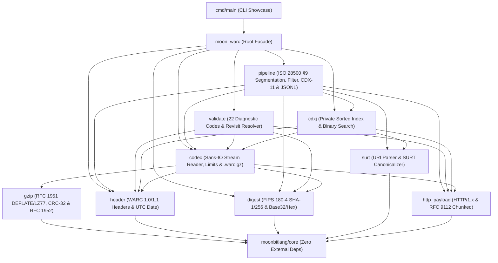
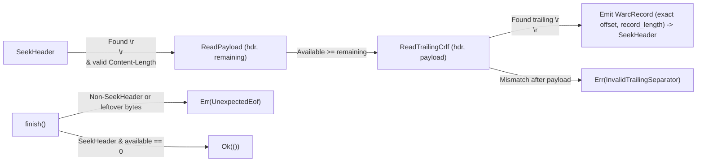
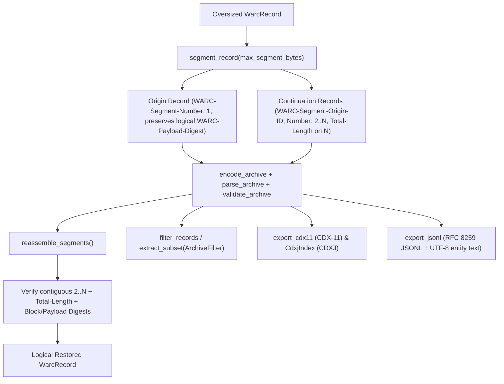

# moon-warc Architecture Guide (`v0.3.1`)

`XinOrigin/moon_warc` is a pure-MoonBit, zero-external-dependency implementation of **ISO 28500 (WARC 1.0 / 1.1)** and **RFC 1951/1952 multi-member `.warc.gz`**, built as a layered **Sans-IO** protocol engine across 11 workspace packages (`moon.mod` version `0.3.1`, 35 `.mbt` files, 189/189 tests passing across `wasm`, `wasm-gc`, `js`, and `native`).

---

## 1. Layered Package DAG



### ASCII Dependency View

```text
                       +-----------------------+
                       |   cmd/main (demo)     |
                       +-----------+-----------+
                                   |
                       +-----------v-----------+
                       | moon_warc (root API)  |
                       +--+----+----+----+---+-+
                          |    |    |    |   |
        +-----------------+    |    |    |   +-----------------+
        v                      v    v    v                     v
+---------------+      +-------+  +-+--+ +----------+  +---------------+
| pipeline (§9, |      | validate| |cdxj| |  codec   |  | digest / hdr  |
| filter,export)|      +----+----+ +--+-+ +----+-----+  +-------+-------+
+---+--+--+--+-+            |         |        |                |
    |  |  |  +--------------+---------+--------+                |
    |  |  |                 |         |        |                |
    v  v  v                 v         v        v                v
 +--+--+--+-----------------+---------+--------+----------------+--+
 |       digest  |  header  |  http_payload  |  surt  |  core      |
 +-----------------------------------------------------------------+
```

Notice the strict **acyclic bottom-up** design:
- Leaf primitives (`digest`, `surt`, `http_payload`) depend solely on `moonbitlang/core`.
- `header` adds ISO 28500 framing types, UTC date validation, and folded headers.
- `codec` drives wire-level streaming and serialization without touching filesystems or sockets.
- `cdxj`, `validate`, and `pipeline` sit atop `codec` for archival indexing, conformance auditing, segmentation/reassembly, subsetting, and corpus export.

---

## 2. Sans-IO Streaming State Machine (`codec/reader.mbt`)

`WarcReader` decouples framing from I/O so the exact same parser runs over Node streams, browser `ReadableStream` chunks, WASM host buffers, or local file reads without conditional compilation.



### Memory & Offset Invariants
1. **Amortized Compaction & Header Scan Watermark**: `WarcReader::compact_if_needed()` resets exhausted buffers immediately and only compacts non-empty buffers when `cursor >= 4096 && cursor >= remaining`, while `header_scan_pos` tracks the `\r\n\r\n` scan watermark across incremental `feed()` calls so large `parse_all()` buffers and multi-chunk streams avoid `O(n²)` copying or rescanning.
2. **Arbitrary Slice Independence**: `codec/fuzz_test.mbt` and `codec/codec_test.mbt` verify identical decoded records, byte offsets, and `record_length` values across chunk boundaries of 1, 2, 3, 5, 7, 13, 17, 32, and 64 bytes (including >64 KB multi-record streams across multiple compaction cycles) — including cases where `\r\n\r\n` straddles chunks or appears inside binary `resource` payloads.
3. **Exact Offset Tracking & Overflow Guard**: `total_consumed` tracks cumulative stream bytes across compaction cycles using `checked_add_i32` (explicitly rejecting `Int32` wraparound) so downstream `CDXJ` / `CDX-11` / `JSONL` exporters receive accurate archive byte offsets within the `Int32` boundary.

---

## 3. Block Digest vs. De-Chunked Payload Digest Closed Loop

ISO 28500 distinguishes two cryptographic integrity levels on HTTP captures:
- **`WARC-Block-Digest`**: SHA-1 or SHA-256 (Base32 or Hex) over the raw WARC record payload bytes (`HTTP/1.x status line + headers + body`, including chunked framing).
- **`WARC-Payload-Digest`**: Digest over the **logical entity payload** inside the record. For HTTP `response` records encoded with `Transfer-Encoding: chunked`, RFC 9112 chunk sizes, `;ext=val` extensions, CRLFs, and trailers must be stripped first via `http_payload::extract_entity_body()`.

Both `codec::encode_record(..., auto_digest=true)` and `validate::validate_archive()` apply this same HTTP parser + chunk decoder, and `scripts/verify_oracle.py` cross-checks both digests against Python's `hashlib` + `base64.b32encode`.

---

## 4. ISO 28500 §9 Segmentation, Filtering & Export Pipeline (`pipeline/`)



### Key Pipeline Guarantees
1. **Digest Preservation Across Wire Re-Encoding**: `codec::encode_record` checks `if h.get("WARC-Segment-Number") is None` before recomputing `WARC-Payload-Digest` on `Response` records, ensuring segmented origin records retain their full logical entity digest while per-segment `Content-Length` and `WARC-Block-Digest` are recomputed automatically.
2. **Validation Rules in `validate`**: `continuation` records require `<...>` wrapped `WARC-Segment-Origin-ID` (`MISSING_SEGMENT_ORIGIN_ID` / `INVALID_SEGMENT_ORIGIN_ID` Errors; `UNRESOLVED_SEGMENT_ORIGIN_ID` Warning if origin missing in stream) and `WARC-Segment-Number >= 2` (`INVALID_SEGMENT_NUMBER` Error). Segmented origin records (`WARC-Segment-Number: 1`) syntax-check `WARC-Payload-Digest`, delegating byte-level entity verification to `reassemble_segments()`.
3. **LLM & Corpus Readiness (`export_jsonl`)**: Extracts de-chunked HTTP bodies or textual resource bodies (`text/*`, `application/json`, `application/xml`, `application/warc-fields`, `application/xhtml+xml`, `+json`, `+xml`), validates strict UTF-8 via `@utf8.decode`, safely truncates by Unicode scalar count (`max_body_chars`), escapes control characters per RFC 8259, and omits `"text"` cleanly on binary or non-UTF-8 payloads.

---

## 5. MoonBit-Specific Engineering Decisions

| Decision | Problem Prevented | Implementation |
| --- | --- | --- |
| Explicit `String::lexical_compare` | MoonBit `String::compare` is shortlex (length-first: `"z"` < `"aa"`), breaking canonical SURT queries and binary search | Used in [`surt/surt.mbt`](../surt/surt.mbt), [`cdxj/cdxj.mbt`](../cdxj/cdxj.mbt), and [`pipeline/filter.mbt`](../pipeline/filter.mbt) (`date_from` / `date_to` normalized to `YYYYMMDDhhmmss`) |
| Unsigned 32/64-bit arithmetic (`UInt32`/`UInt64`) | JS numbers vs 32-bit Wasm / Native signed overflow divergence in bitwise digest rounds | [`digest/sha1.mbt`](../digest/sha1.mbt) & [`digest/sha256.mbt`](../digest/sha256.mbt) verified bit-identical across `wasm`, `wasm-gc`, `js`, `native` |
| `Bytes` / `BytesView` payload slicing | UTF-8 normalization or NUL termination mangling binary HTTP bodies (`\x00\r\n\r\n\xff`) | [`http_payload/http_payload.mbt`](../http_payload/http_payload.mbt) & [`codec/reader.mbt`](../codec/reader.mbt) never convert arbitrary bodies to `String` unless verified valid UTF-8 for textual `export_jsonl` |
| Minimal core-only `.moon` dependency footprint | Host/FFI incompatibilities blocking browser Wasm or Mooncakes reuse | Zero `[deps]` in [`moon.mod`](../moon.mod); all crypto, Base32/Hex, URI, HTTP, WARC, CDX/CDXJ, and JSONL logic lives inside the repository |
